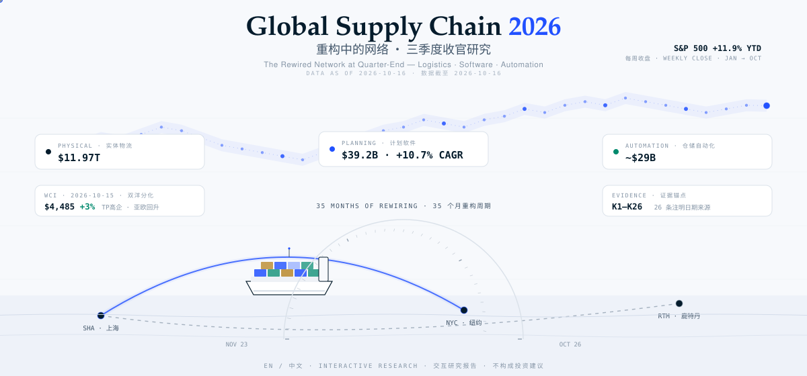

<p align="center">
  <a href="./README.md">English</a> · <strong>中文</strong>
</p>

<p align="center">
  
</p>

<p align="center">
  <strong>一份交互报告，两种语言，二十六条注明日期的来源锚点。</strong><br>
  聚焦 2026 年三季度末的全球物流、供应链软件、贸易政策、关键通道、自动化与智能体 AI。
</p>

<p align="center">
  <code>原生 JavaScript</code> · <code>D3.js</code> · <code>HTML Canvas</code> · <code>EN / 中文</code> · <code>无需构建</code>
</p>

---

## 这份报告展示什么

实体网络与决策层正在以不同速度变化：

- **11.97 万亿美元的实体层**：船舶、港口、仓库、卡车及其周边服务。
- **392 亿美元的计划层**：供应链管理软件，复合年增长率为 **10.7%**。
- **51% 的智能体 AI 采用信号**：供应链负责人正在试点或部署智能体。
- **被政策重新定价的网络**：关税、苏伊士复航、碳成本与近岸外包。

报告将这些判断转化为可交互的证据：带测量点的集装箱船、35 个月事件时间线、12 个标的的市场面板、运价航线、技术采用门槛、情景概率，以及一个可以被证伪的最终结论。

> **研究范围：**不提供评级、目标价或投资建议。推算值会明确标注；实时数据不可用时，界面会清楚说明并回退到注明日期的快照。

## 证据链

每个重要数字都对应一条注明日期的来源锚点（`K1` 至 `K26`），并按与原始证据的接近程度分级：

```text
公司一手披露
    ↓
交叉核验的行业或官方数据
    ↓
券商转述
    ↓
研究汇编 / 推算值 [已标注]
```

市场数据截至 **2026-10-16**。情景概率是明确标注的主观研究判断，并非市场隐含概率。

## 报告内容

1. **一艘船，八项测量**：把最关键的数字放在真实会被测量的位置。
2. **行业解剖**：同时衡量全球物流、第三方物流、供应链软件与仓储自动化。
3. **重塑地图的 35 个月**：从短期扰动走向结构性政策变化。
4. **原子与比特**：物流与软件股票表现，以及世界集装箱指数航线。
5. **五个正在发生的争论**：关税、苏伊士、智能体 AI、碳监管与劳动力。
6. **采用门槛与情景**：什么能够落地、什么会停滞、接下来观察什么。
7. **可证伪的结论**：支持“韧性优先”的证据，以及能够推翻结论的条件。

完整体验包括中英文切换、点击下钻的来源引用、四种生成式封面模式，以及带有明确快照回退说明的实时行情刷新。

## 本地运行

无需安装软件包或构建工具：

```bash
python3 -m http.server 8000
```

打开 [http://localhost:8000](http://localhost:8000)，使用语言切换按钮，并点击图表标注查看来源。

如需便携版本，可直接打开 `dist-single.html`。样式、脚本、字体和地图数据均已包含在单个文件中。

重新生成单文件版本：

```bash
python3 bundle.py
# 或
python3 bundle.py custom-output.html
```

## 作为编辑型研究作品构建

这是一个有意保持静态的研究版本，而不是应用框架：

```text
呈现            手写 HTML + 编辑型 CSS
可视化          D3.js v7 + TopoJSON + HTML Canvas
数据            内联且可版本化的 JavaScript 对象
实时行情        stooq.com 公共 CSV 接口，无需 API 密钥
语言            自定义 EN / 中文运行时切换
打包            Python 打包器，生成单个自包含 HTML
运行时          无后端、数据库、框架或软件包安装
```

视觉系统来自报告本身：ET Book 用于编辑型分析，等宽字体用于测量标签，深海军蓝作为文本色，电蓝色表示路径，并使用语义颜色区分正向、风险与推算数据。

<details>
<summary><strong>项目结构</strong></summary>

```text
.
├── index.html              # 报告结构与叙事
├── dist-single.html        # 便携式单文件版本
├── bundle.py               # 内联完整报告
├── css/
│   ├── style.css           # 编辑型布局与图表系统
│   └── fonts.css           # 自包含 ET Book 字体
├── js/
│   ├── data.js             # 市场、行业、情景和时间线数据
│   ├── sources.js          # K1 至 K26 证据登记册
│   ├── i18n.js             # 双语运行时
│   ├── cover*.js           # 四种 Canvas 封面模式
│   ├── chart-*.js          # 报告可视化
│   └── dashboard.js        # 周期侧栏与网络地图
└── vendor/                 # 本地 D3、TopoJSON 与世界地图数据
```

</details>

## 许可证

本仓库采用双重许可模式：

- **软件代码：**原创软件代码采用 [MIT License](./LICENSE)。
- **研究内容：**原创叙事文本、数据选择与汇编、图表、图形、视觉设计及编辑资产均为 **© 2026 SummerPapaya。保留所有权利。** 未经事先书面许可，不得复制、修改、再分发、再许可或用于商业用途。
- 第三方库、引用出版物、公司材料与源数据仍受各自权利人的条款约束。

完整范围与条款见 [LICENSE](./LICENSE)。

## 兼容性与限制

- 建议使用现代桌面浏览器；移动端仍可阅读，但密集图表更适合宽屏。
- 使用 `file://` 打开时，实时行情请求可能被阻止；请通过本地服务器获得完整体验。
- 行情接口不可用时，界面会明确提示并使用已核验快照。
- 本报告是注明日期的研究版本，并非自动维护的市场数据服务。

---

<p align="center">
  <sub>交互研究版 · 数据截至 2026-10-16 · 证据分级 · 不构成投资建议</sub>
</p>
